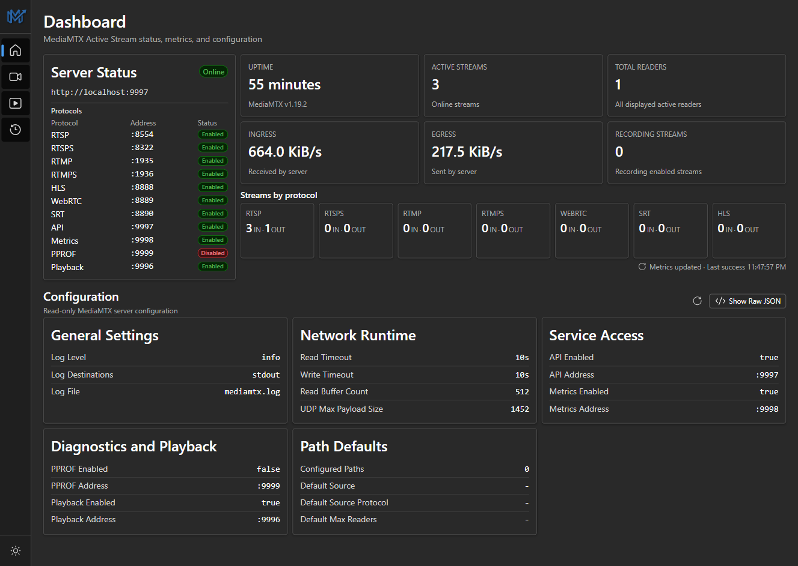
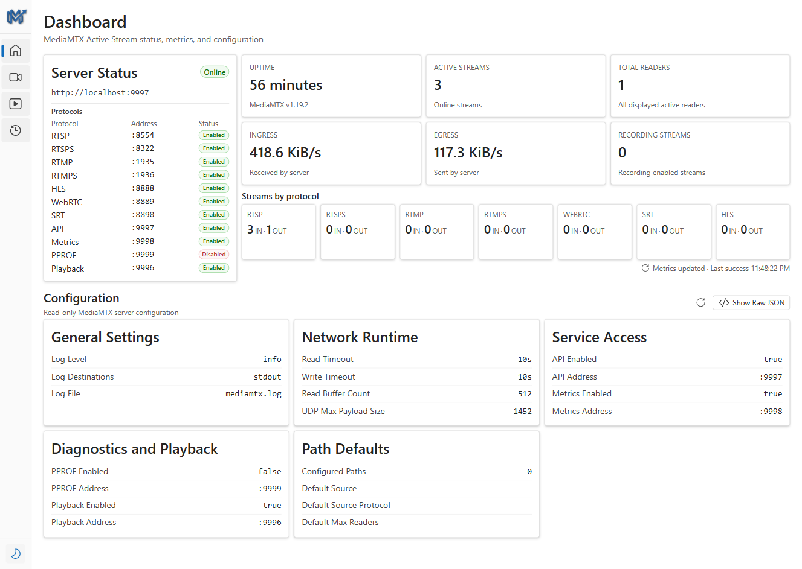
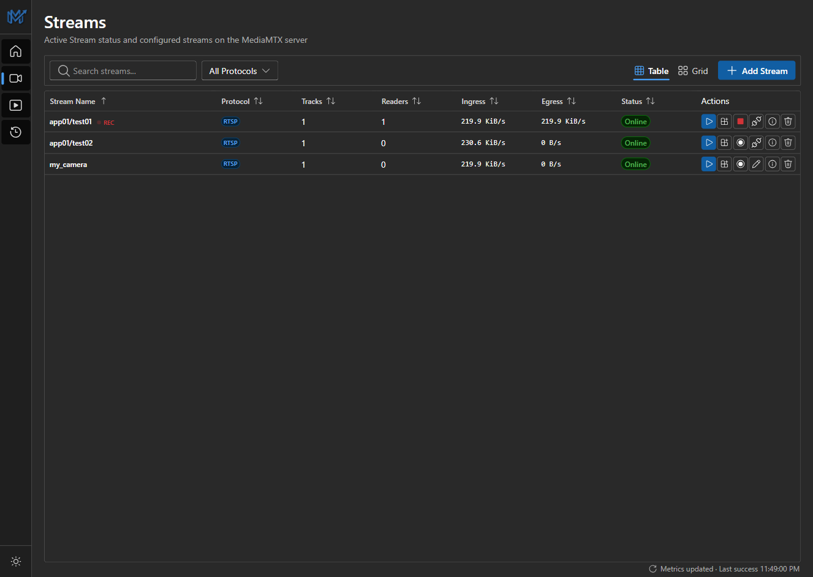
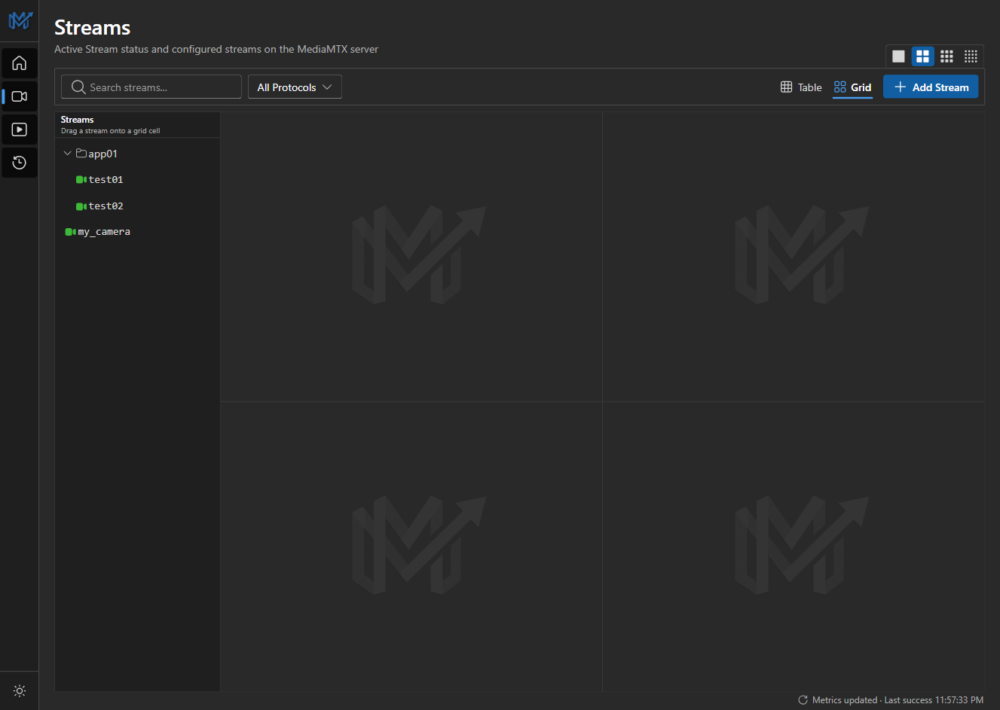
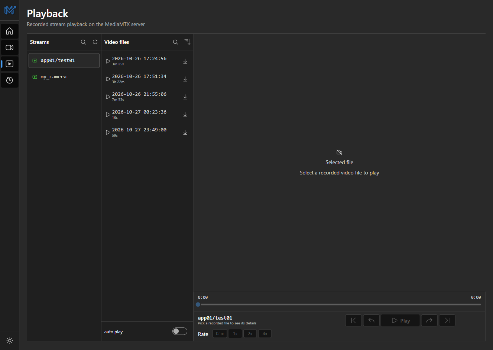
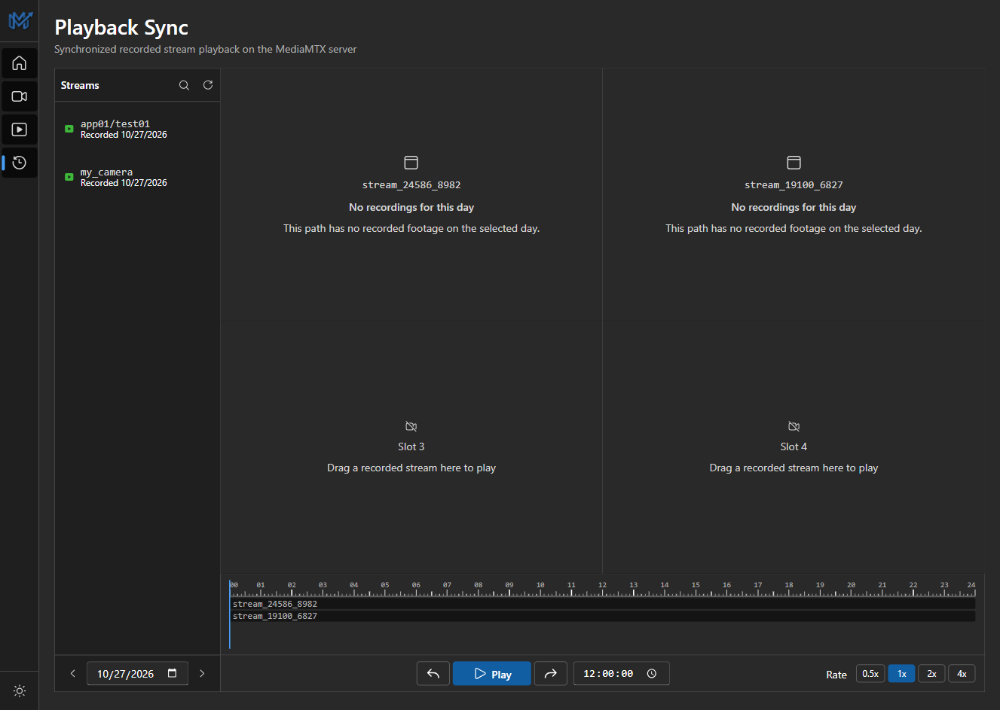

# MediaMTX Client

[](https://mediamtx-client.github.io/)
[](https://react.dev/)
[](https://www.typescriptlang.org/)
[](https://vitejs.dev/)
[](https://hub.docker.com/)

A modern, browser-based management console for the [MediaMTX](https://mediamtx.org/) live media server and proxy. Monitor server health, inspect real-time metrics, configure streams, watch live feeds, and review recorded footage with synchronized multi-camera playback.

## Table of Contents

- [Overview](#overview)
- [Screenshots](#screenshots)
- [Features](#features)
- [Architecture](#architecture)
- [Tech Stack](#tech-stack)
- [Project Structure](#project-structure)
- [Getting Started](#getting-started)
  - [Prerequisites](#prerequisites)
  - [Docker](#docker)
  - [Local Development](#local-development)
  - [Quality Checks](#quality-checks)
- [Testing](#testing)
- [Transfer Rate Metrics](#transfer-rate-metrics)
- [Limitations](#limitations)
- [Roadmap](#roadmap)
- [Contributing](#contributing)

## Overview

MediaMTX Client runs 100% in the browser and connects directly to your MediaMTX server. No backend service, local database, or installation is required.

- **Zero Install:** Use the live app directly at [mediamtx-client.github.io](https://mediamtx-client.github.io/) or open the compiled `dist/index.html` file in any modern web browser.
- **Privacy & Security:** No analytics, tracking, or remote telemetry. All requests stay between your browser and your MediaMTX instance.
- **Portable Distribution:** Packaged with a single standalone HTML bundle that can be hosted anywhere or run offline.
- **Docker Ready:** Run via Docker in a secure, read-only container without installing local runtimes.
- **Network Requirements:** Ensure your browser can reach the MediaMTX API and playback endpoints. When serving the client over HTTPS, MediaMTX API endpoints must also use HTTPS to avoid browser mixed-content restrictions. If accessing across domains, enable CORS in `mediamtx.yml`.

## Screenshots

<table border="1">
  <tr>
    <td width="50%"><a href="screenshots/dashboard.png"></a></td>
    <td width="50%"><a href="screenshots/dashboard-light.png"></a></td>
  </tr>
  <tr>
    <td width="50%"><a href="screenshots/streams-table.png"></a></td>
    <td width="50%"><a href="screenshots/streams-grid.png"></a></td>
  </tr>
  <tr>
    <td width="50%"><a href="screenshots/playback.png"></a></td>
    <td width="50%"><a href="screenshots/playback-sync.png"></a></td>
  </tr>
</table>

## Features

### Dashboard & Server Health

- **Live Server Metrics:** Uptime, total streams, recording streams, reader counts, and aggregate transfer rates.
- **Protocol Listeners:** Active listener addresses for WebRTC, RTSP, RTMP, HLS, and SRT.
- **Configuration Inspector:** Grouped settings overview with an on-demand raw JSON viewer.
- **Connection Status:** Real-time health indicators and customizable API endpoint settings.

### Stream Management

- **Search & Filter:** Find streams quickly by name, state, or protocol.
- **Stream Inventory:** Sortable table displaying tracks, readers, ingress/egress rates, and recording status.
- **Lifecycle Actions:** Add new paths with source URI validation, edit configurations, delete paths, or kick active sources.
- **Details Drawer:** Inspect media tracks, active reader sessions, and generated playback URLs.

### Live Playback & Multi-Camera Grid

- **Low-Latency Streaming:** WebRTC (WHEP) first with automatic fallback to HLS (`hls.js`).
- **Protocol URLs:** Ready-to-copy playback links for WebRTC, HLS, RTSP, RTMP, and SRT.
- **Multi-Player Grid:** Flexible 1×1, 2×2, 3×3, and 4×4 video wall.
- **Drag-and-Drop Assignment:** Easily drag streams into player slots or rearrange active players.

### Recording & Playback Review

- **Recording Controls:** Toggle recording on active streams with confirmation prompts.
- **File Browser:** Browse recorded MP4 segments with timestamps, durations, and file sizes.
- **Segment Viewer:** Seek bar, variable playback speed (0.5×–2×), autoplay next segment, and direct MP4 downloads.

### Synchronized Multi-Stream Playback

- **Multi-Slot Review:** Compare up to 4 recorded camera feeds simultaneously.
- **Date Navigation:** Calendar-based day selector for recorded footage.
- **Shared Timeline:** Interactive multi-track timeline showing recording intervals for all active feeds.
- **Lockstep Scrubbing:** Unified play/pause and time synchronization across all camera feeds.

## Architecture

MediaMTX Client is a pure single-page application requiring no backend service other than MediaMTX.

- **Direct API Communication:** Direct REST and playback requests to MediaMTX endpoints (`:9997` API, `:9996` Playback by default).
- **State Management:** Zustand manages application state, user preferences, live player assignments, and timeline clocks.
- **Automatic Polling:** Visible paths and server status refresh every 3 seconds and automatically pause when the browser tab is hidden.
- **Single-File Artifact:** The production build compiles all scripts, styles, and assets into one standalone `index.html`.

## Tech Stack

| Category                      | Technology                                 |
| :---------------------------- | :----------------------------------------- |
| **Framework**                 | React 18, TypeScript                       |
| **Build Tool**                | Vite 6, `vite-plugin-singlefile`           |
| **Runtime & Package Manager** | Bun                                        |
| **UI Components**             | Microsoft Fluent UI React, Fluent UI Icons |
| **Styling**                   | Tailwind CSS, PostCSS                      |
| **State Management**          | Zustand                                    |
| **Media Playback**            | Native HTML5 Video, WebRTC WHEP, `hls.js`  |
| **Drag & Drop**               | `@atlaskit/pragmatic-drag-and-drop`        |
| **Validation**                | Zod                                        |

## Project Structure

```text
.
|-- dist/
|   `-- index.html              # Portable single-file application
|-- docs/
|   |-- mediamtx-api.http       # MediaMTX API request examples
|   `-- mediamtx-openapi.yaml   # OpenAPI specification
|-- screenshots/                # Application preview images
|-- src/
|   |-- api/                    # MediaMTX API and playback helpers
|   |-- assets/                 # Icons and image assets
|   |-- components/             # Reusable UI components
|   |   |-- common/             # Shared UI primitives
|   |   |-- config/             # Configuration summaries and JSON view
|   |   |-- dashboard/          # Server status and metric widgets
|   |   |-- layout/             # Header, sidebar, and shell layout
|   |   |-- playback/           # Recorded file player components
|   |   `-- streams/            # Stream table, cards, drawers, and live grid
|   |-- hooks/                  # API data fetching and polling hooks
|   |-- pages/                  # Dashboard, Streams, Playback, and Playback Sync
|   |-- playbackSync/           # Shared timeline clock controller
|   |-- router/                 # Route definitions
|   |-- schemas/                # Zod schemas for API validation
|   |-- store/                  # Zustand stores
|   |-- styles/                 # Tailwind CSS styles
|   |-- types/                  # TypeScript type declarations
|   `-- utils/                  # Formatting, calculation, and time helpers
|-- tests/                      # Unit and integration test suites
|-- package.json
`-- vite.config.ts
```

## Getting Started

### Prerequisites

A running [MediaMTX](https://mediamtx.org/) instance with API access enabled:

- **Control API:** `http://localhost:9997` (default)
- **Playback Server:** `http://localhost:9996` (default)

_Endpoints can be updated at any time in the client settings drawer._

### Docker

Run the client in a secure, read-only Docker container without installing local toolchains:

```bash
# Build the Docker image
docker build -t mediamtx-client .

# Run the container
docker run -d --name mediamtx-client -p 8080:8080 --read-only --cap-drop=ALL --security-opt=no-new-privileges mediamtx-client
```

Open [http://localhost:8080](http://localhost:8080) in your browser.

To stop and remove the container:

```bash
docker stop mediamtx-client
docker rm mediamtx-client
```

### Local Development

Local development requires [Bun](https://bun.sh/):

```bash
# Install dependencies
bun install

# Start local dev server
bun run dev

# Build the portable single-file bundle
bun run build

# Preview production build locally
bun run preview
```

### Quality Checks

Run the verification test suites and linters:

```bash
bun run test        # Run unit and component tests
bun run typecheck   # Typecheck TypeScript code
bun run lint        # Lint source files with ESLint
```

## Testing

The project includes test coverage for core workflows and UI components:

- User preference and theme persistence (Light / Dark mode).
- Server uptime calculations and API connection state handling.
- Playback URL generation for WebRTC, HLS, RTSP, RTMP, and SRT.
- Stream actions (add, edit, delete, recording toggle, kick source).
- Live grid slot management and drag-and-drop interactions.
- Recorded file formatting and player state management.
- Multi-camera synchronized playback controller and timeline alignment.

## Transfer Rate Metrics

- **Average Sampling:** Ingress and egress rates are calculated from byte counter deltas divided by elapsed polling intervals (~3 seconds). They represent moving averages, not instantaneous spikes.
- **Counter Prioritization:** Modern `inboundBytes` and `outboundBytes` counters take precedence over legacy aliases.
- **Edge Case Handling:** First samples, counter resets, or request timeouts display an unavailable dash (`-`) until two consecutive samples are recorded.
- **Dashboard Aggregates:** Total server rates sum active stream rates and report partial coverage when individual stream counters are pending.

## Limitations

- **Configuration Persistence:** MediaMTX (as of v1.19.2) does not automatically persist API-created configuration changes to its `mediamtx.yml` file.
- **HTTPS & Mixed Content:** If the client is hosted on an HTTPS origin, MediaMTX API and playback endpoints must also use HTTPS.
- **Authentication:** Direct authentication against password-protected MediaMTX API endpoints is currently in development.

## Roadmap

- [x] Docker deployment support
- [ ] Docker Compose setup for MediaMTX server + client
- [ ] Authentication support for secured MediaMTX API endpoints
- [ ] Packaged desktop application (Electron / Tauri)

## Contributing

Contributions, feedback, and issue reports are welcome:

- Report bugs with browser, MediaMTX version, and error details.
- Submit feature suggestions with specific operational use cases.
- Open pull requests for targeted bug fixes and feature additions.
